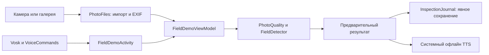

# Карта проекта

Это карта назначения файлов. Что уже проверено и что делать дальше — в [STATUS](STATUS.md).
Подробное устройство — в [техническом отчёте](architecture/PROJECT_REPORT_2026-10-19.md).

```text
agrovoice-ai/
├── README.md                 вход, сборка, ограничения
├── AGENTS.md / CLAUDE.md     правила работы агентов
├── LICENSE / ATTRIBUTION.md  лицензия проекта и происхождение компонентов
├── android-app/             исполняемое приложение Android
│   ├── app/src/main/        приложение, манифесты, ресурсы
│   ├── app/src/debug/       лабораторные Activity
│   ├── app/src/test/        JVM-тесты
│   ├── app/src/androidTest/ инструментальные сценарии
│   ├── branding/            оригинал логотипа и генератор
│   └── fetch_assets.py      проверка/получение локальных моделей
├── ml-pipeline/             данные, экспорт, обучение и история экспериментов
│   ├── allcrops/            неизменяемые ID taxonomy_v1
│   ├── external/            новые источники и подготовка наборов
│   ├── assistant/           корпус намерений русского помощника
│   ├── gpu_kit/             обучение на арендованной GPU
│   │   └── alternatives/   конфиги сравнения и упаковщики новых данных
│   ├── tests/              Python-тесты
│   ├── dataset*/           локальные подготовленные наборы, вне git
│   └── source_candidates/  локальные исходники, вне git
├── docs/                    документация по назначению, см. docs/README.md
├── artifacts/               локальные APK, пакеты GPU, проверки, release staging
└── runs/                    результаты запусков, вне git
```

## Android: от действия до результата

| Ответственность | Основной исходник |
|---|---|
| Запуск, разрешения, переключение режимов, голосовая диспетчеризация | [FieldDemoActivity.kt](../android-app/app/src/main/java/com/agronomy/phytomonitor/FieldDemoActivity.kt) |
| Состояние, фоновый анализ, сохранение осмотра | [FieldDemoViewModel.kt](../android-app/app/src/main/java/com/agronomy/phytomonitor/FieldDemoViewModel.kt) |
| Экран результата и журнала | [MainScreen.kt](../android-app/app/src/main/java/com/agronomy/phytomonitor/MainScreen.kt) |
| Камера и нумерованная галерея | [photos/](../android-app/app/src/main/java/com/agronomy/phytomonitor/photos/) |
| Загрузка ONNX и инференс | [FieldDetector.kt](../android-app/app/src/main/java/com/agronomy/phytomonitor/ml/FieldDetector.kt) |
| Декодирование выходов YOLO, рамки, NMS | [YoloPostprocessor.kt](../android-app/app/src/main/java/com/agronomy/phytomonitor/ml/YoloPostprocessor.kt) |
| Импорт, EXIF, сохранение результата | [PhotoFiles.kt](../android-app/app/src/main/java/com/agronomy/phytomonitor/ml/PhotoFiles.kt) |
| Предупреждения качества и формулировки результата | [PhotoQuality.kt](../android-app/app/src/main/java/com/agronomy/phytomonitor/PhotoQuality.kt), [AnalysisAssessment.kt](../android-app/app/src/main/java/com/agronomy/phytomonitor/AnalysisAssessment.kt) |
| Журнал и экспорт JSON | [InspectionJournal.kt](../android-app/app/src/main/java/com/agronomy/phytomonitor/InspectionJournal.kt) |
| Vosk, команды, системная озвучка | [voice/](../android-app/app/src/main/java/com/agronomy/phytomonitor/voice/) |
| Реальные модельные классы и подписи | [models/manifest.json](../android-app/app/src/main/assets/models/manifest.json) |
| Версии библиотек и APK | [build.gradle.kts](../android-app/app/build.gradle.kts), [libs.versions.toml](../android-app/gradle/libs.versions.toml) |



Сервер, веб-панель, Room, локальная LLM и verified-справочник — будущие компоненты;
каталоги-заглушки под них не создаются. Их контракты следует проектировать в соответствующих карточках ROADMAP.

## ML: что считать действующим

Вход — [ml-pipeline/README](../ml-pipeline/README.md). Корень пайплайна содержит
как нужные сборщики, так и старые скрипты. Название `train_*` само по себе не означает
актуальный способ обучения. Новый код добавлять в профильные каталоги.

Пути `docs/experiments`, `docs/android`, `docs/session` сохранены: они используются
историческими генераторами, проверками и сборкой данных. Научные результаты, source snapshots,
таксономия, веса и наборы не редактируются ради внешнего порядка.

## Что изменилось при сортировке

| Было | Стало |
|---|---|
| `docs/PROJECT_REPORT_2026-10-19.md` | `docs/architecture/PROJECT_REPORT_2026-10-19.md` |
| `docs/TRAINING_PLAYBOOK.md` | `docs/guides/TRAINING_PLAYBOOK.md` |
| `docs/AUDIT_AND_PLAN_2026-10-16.md` | `docs/audits/AUDIT_AND_PLAN_2026-10-16.md` |
| `docs/ANALOGUES_2026-10-19.md` | `docs/research/ANALOGUES_2026-10-19.md` |
| `docs/reports/` | `docs/history/reports/` |
| Исследования 3–5 октября, их приложения и шаблоны в `docs/research/` | `docs/history/research/` |

Ссылки в Markdown и пути в затронутых генераторах обновлены. Абсолютные пути внутри
сохранённых JSON экспериментов описывают исходное окружение; их нельзя переписывать
как будто опыт проводился в новой структуре. Старые ZIP также сохраняют прежнюю структуру:
инструкции внутри такого ZIP читаются относительно самого ZIP.
