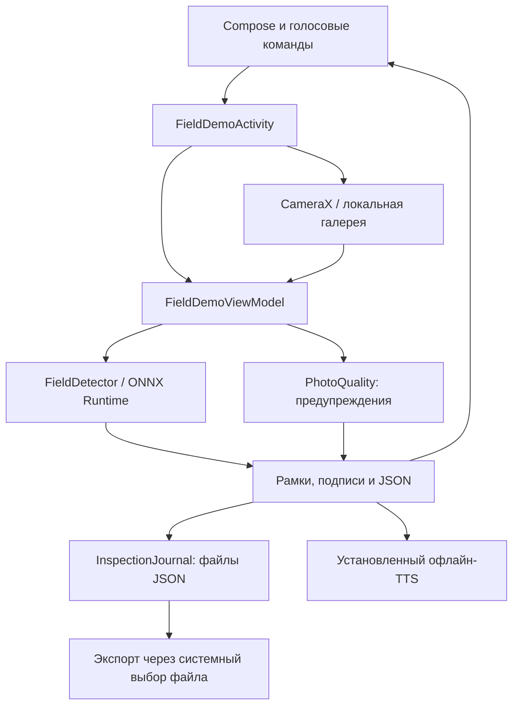

# AgroVoice AI: полный технический отчёт

Срез на 19.10.2026. Основание — исходники, конфигурация сборки, манифесты, сохранённые результаты и проверки текущего изменения. Это описание фактической реализации и плана, а не процент готовности по субъективной оценке. Оперативное состояние ведётся только в [STATUS.md](STATUS.md).

## 1. На каком этапе проект

**Есть работающий автономный Android-прототип осмотра листьев с несколькими моделями, голосовыми командами, озвучкой и файловым журналом. До надёжного агрономического помощника ещё не реализованы ключевые части: распознавание неизвестного, проверенная база рекомендаций, свободный диалог и сервер.**

Подготовлен расширенный набор и комплект обучения на арендованной GPU. Это не означает, что новая модель уже обучена или встроена. Текущий APK использует **30 старых классов**, тогда как `taxonomy_v1` описывает **49 классов и 15 культур**. Поддержка культуры в таксономии не означает поддержку всех её болезней. Нет основания обещать диагностику любого растения, устойчивость к любой тени или качество уровня большой универсальной модели.

Последний пользовательский запрос расширил направление: логотип, альтернативы YOLO, открытые классы/отказы, свободный русский голос, локальная LLM и источники лечения. Для этого подготовлены:

- [Зрение: сравнение архитектур, причины ошибок, протокол проверки](research/ROBUST_VISION_2026-10-19.md).
- [Голос: локальные модели, runtime, дообучение и сценарии без рук](research/LOCAL_ASSISTANT_2026-10-19.md).
- [Каталог литературы: Беларусь, международные справочники, конкретные главы и ограничения доступа](research/AGRONOMY_LIBRARY_2026-10-19.md).

## 2. Функциональная готовность

| Подсистема | Реализовано | Что остаётся |
|---|---|---|
| Android-интерфейс | Compose, фото в центре, действия, настройки, рамки, результат, широкая раскладка, reduced motion и семантика доступности | Проверка всего нового интерфейса с пользователями/TalkBack и крупным шрифтом; полноценная экранная архитектура |
| Камера и галерея | CameraX, локальная нумерованная галерея, выбор/подтверждение голосом | Наведение без взгляда на экран, подсказки живого видоискателя, устранение дублирования снимков |
| Инференс | ONNX Runtime, несколько моделей, обработка боксов, двухэтапные режимы | Манифест классов каждой модели, allcrops, отдельный механизм unknown, калиброванный отказ |
| Качество кадра | Неблокирующие подсказки по яркости/детализации после получения фото, озвучка и поля в JSON | Калибровка на реальных кадрах, ROI листа, live preview, измерение ложных предупреждений |
| Голос | Vosk, команды по экрану, повторное слушание, свободная диктовка заметки | Понимание произвольных поручений, контекстный диалог и слоты, гарнитура как проверенный полный сценарий, wake word |
| Озвучка | Выбор установленного русского голоса, не требующего сети | Встроенный голос для чистого телефона; обработка прерывания и эха в полном диалоге |
| Журнал | JSON-осмотры, участок как текст, заметка, пользовательская оценка, поиск/фильтр и JSON-экспорт | Room, миграции, импорт/восстановление, CSV, GPS, структурированные участки, очередь синхронизации |
| Рекомендации | Библиография, проект формата в ROADMAP | `kb/`, verified-карточки, эксперт, экран справочника, retrieval, обновление регистрационных записей |
| Локальная LLM | Исследование и протокол следующего инкремента | Runtime, веса, корпус действий, SFT, измерения, интеграция |
| Сервер и веб | Проект стека в ROADMAP | `server/`, API, БД, синхронизация, панель и развёртывание отсутствуют |
| Релиз | Скрипты проверки ассетов и подготовки моделей, debug APK | Опубликованные allcrops-артефакты, release signing/R8, field/lab flavors, воспроизводимость чистого клона |

## 3. Карта файлов и ответственность компонентов

Все пути ниже относительно корня `F:\agrovoice-ai`.

| Путь | Назначение |
|---|---|
| `AGENTS.md`, `docs/STATUS.md`, `docs/ROADMAP.md` | Правила, текущее состояние, карточки работ |
| `android-app/app/src/main/AndroidManifest.xml` | Разрешения и точка входа `FieldDemoActivity`; приложение `com.agronomy.phytomonitor` |
| `…/java/com/agronomy/phytomonitor/FieldDemoActivity.kt` | Координация экранов, разрешений, голоса, камеры и экспорта |
| `…/FieldDemoViewModel.kt` | Состояние осмотра, выбранная модель/культура/порог, фоновый анализ, сохранение |
| `…/MainScreen.kt`, `…/ui/`, `…/ui/theme/` | Compose-интерфейс, подписи, компоненты, тема, motion и доступность |
| `…/photos/PlantCamera.kt`, `NumberedGallery.kt`, `LocalPhotoGallery.kt` | Камера, выбор локальных фото, состояние фото-сценария |
| `…/ml/FieldDetector.kt`, `YoloPostprocessor.kt` | ONNX-сессии, подготовка изображения, YOLO/DETR/двухэтапный инференс |
| `…/ml/PhotoFiles.kt`, `AnalysisReport.kt` | Чтение/подготовка фото, сохранение результата и метаданных |
| `…/PhotoQuality.kt`, `AnalysisAssessment.kt` | Эвристики качества и описательное состояние результата |
| `…/voice/` | ASR Vosk, правила команд, системный офлайн-TTS |
| `…/InspectionJournal.kt`, `InspectionTools.kt` | JSON-журнал и его интерфейс |
| `android-app/app/src/main/assets/models/manifest.json` | Список текущих моделей, общий список классов, SHA, параметры и происхождение |
| `android-app/app/src/main/assets/voice/manifest.json` | Vosk-модель, источник, размеры и контрольные суммы |
| `android-app/branding/` | Приложенный оригинал логотипа и воспроизводимый генератор ресурсов |
| `android-app/fetch_assets.py`, `model_release.json` | Проверка/получение ассетов; конфигурация будущего релиза |
| `android-app/app/src/test/`, `src/androidTest/`, `src/debug/` | JVM-тесты, тесты на устройстве, технические Activity для проверки/замеров |
| `ml-pipeline/allcrops/taxonomy_v1.json` | Неизменяемый порядок классов новой линии |
| `ml-pipeline/build_allcrops_v1.py` | Сборка основного расширенного набора |
| `ml-pipeline/external/` | Источники, сопоставление классов, сборщик дополнения ext_v2 |
| `ml-pipeline/gpu_kit/`, `pack_gpu_kit.py` | Очередь обучения, ограничение времени, продолжение, оценка и экспорт на арендованной GPU |
| `ml-pipeline/prepare_model_release.py` | Подготовка ONNX, контрольных сумм, карточки модели и конфигурации публикации |
| `ml-pipeline/tests/` | Проверки сборщиков, комплектов, экспорта/подготовки релиза |
| `docs/experiments/`, `docs/android/` | Первичные результаты прежних экспериментов и испытаний устройств |
| `docs/data/`, `ATTRIBUTION.md` | Источники данных и условия использования |
| `docs/thesis/`, `docs/history/`, `docs/reports/` | Материалы диплома, архивное описание проекта и тематические отчёты |
| `artifacts/apk/`, `artifacts/gpu_kit/`, `artifacts/release/`, `artifacts/verification/` | Локальные сборки, комплекты, релизные файлы и протоколы проверок; вне git |

Знак `…` в Android-строках означает `android-app/app/src/main/java/com/agronomy/phytomonitor`. Старые корневые Python-эксперименты — история для переиспользования, не текущая очередь развития.

## 4. Стек и версии

Версии конфигурации не следует путать с «последними доступными в интернете». Источники: [build.gradle.kts](../android-app/app/build.gradle.kts), [libs.versions.toml](../android-app/gradle/libs.versions.toml), [Gradle wrapper](../android-app/gradle/wrapper/gradle-wrapper.properties), [JVM toolchain](../android-app/gradle/gradle-daemon-jvm.properties), [локальный report.json](../artifacts/verification/research_20261019/report.json).

| Компонент | Фактическая конфигурация |
|---|---|
| Версия приложения | `versionCode = 18`, `versionName = 0.18-field` |
| Android SDK | min 26, compile 37, target 37 |
| ABI | `arm64-v8a`, `armeabi-v7a` |
| Gradle / AGP | 9.6.0 / 9.4.1 |
| JVM toolchain / bytecode | JDK 25 / Java 11 compatibility |
| Compose plugin / BOM | Kotlin Compose plugin 2.2.10 / Compose BOM 2026.02.01; не утверждение о версии всех Compose-компонентов |
| Activity Compose / Lifecycle | 1.8.0 / 2.6.1 |
| Core KTX / ExifInterface | 1.10.1 / 1.4.2 |
| CameraX | 1.4.2 |
| ONNX Runtime Android | 1.30.0 |
| Vosk Android / JNA | 0.3.75 / 5.18.1 |
| Голосовая модель | `vosk-model-small-ru-0.22`, Apache-2.0 |
| Тесты | JUnit 4.13.2, AndroidX JUnit 1.1.5, Espresso 3.5.1, Compose UI tests через BOM |
| Python venv | Python 3.12.10; `ml-pipeline/venv` |
| Локальный ML-стек | PyTorch 2.14.0, Ultralytics 8.4.164, ONNX 1.20.1, ONNX Runtime Python 1.26.0, Pillow 12.3.0 |
| GPU kit | Ultralytics закреплён в `requirements-gpu.txt`; PyTorch ставится отдельно под CUDA; остальные зависимости частично заданы нижними границами |
| Планируемый сервер | FastAPI, PostgreSQL, SQLAlchemy 2, Alembic, Pydantic v2, JWT, Jinja2/HTMX/Leaflet; **не установленный стек работающего сервера** |

Последствия: текущая сборка работает в существующем окружении, но зависимости GPU-комплекта не являются полностью фиксированным lockfile. При аренде сохранять фактическое окружение каждого прогона. Домашнюю RX 9060 XT под обучение не занимать; WSL/ROCm в архиве не является разрешением запускать обучение там.

## 5. Фактическая архитектура Android



Activity остаётся крупным координатором, экраны переключаются состояниями. Для фоновых задач используются `Executors` и `Handler`; полноценного слоя Navigation/Room/repository/Flow ещё нет. Часть старого Kotlin-кода с несколькими операторами в строке затрудняет сопровождение. Новый голосовой исполнитель лучше выделять постепенно, сохраняя существующие сценарии.

`FieldDetector` проверяет формы тензоров и SHA при подготовке файла, хранит рабочую модель и при необходимости классификатор, закрывает сессии при смене режима. ORT здесь не настроен на специальный NNAPI/GPU execution provider: нельзя приписывать приложению ускорение NPU. Потоки заданы в коде; их число не доказывает оптимальность на каждом телефоне.

Обычный YOLO-граф принимает RGB NCHW и возвращает каналы координат/классов; приложение делает собственную постобработку. DETR-декодер принимает специально экспортированные строки боксов/score/class. Совпадение формы `[1,300,6]` само по себе не делает YOLO26 end-to-end голову совместимой: нужны те же координаты, порядок полей и семантика экспорта. По правилам проекта для Android используется обычная голова YOLO с `end2end=False`, `nms=None`.

## 6. Какие модели находятся в APK

Источник всех записей — [manifest.json](../android-app/app/src/main/assets/models/manifest.json), `schema = 2` с общими классами/подписями. Все ассеты проверены `fetch_assets.py --check`. Наличие файла подтверждает комплектность APK, не диагностическую точность.

| Режим | Цепочка | Статус в манифесте |
|---|---|---|
| `yolo11n` | Прямой детектор | `provisional: false`, историческая линия clean v2 |
| `yolo26n` | Прямой детектор | `provisional: false`, значение по умолчанию для новой установки в ViewModel |
| `yolo26s` | Прямой детектор | `provisional: false`, выбранный checkpoint серии S |
| `yolo26m` | Прямой детектор из `models/model_lab/` | Предварительный технический пилот |
| `deimv2_n` | DETR | Предварительный; закрытые условия весов, не публиковать |
| `mobilenet_v3_large` | YOLO26n → классификатор вырезок | Предварительный |
| `efficientnet_b0` | YOLO26n → EfficientNet-B0 | Предварительный |
| `masked_mobilenet_v3_large` | YOLO26n → классификатор с маской | Предварительный, маска целого листа, не площади болезни |
| `distilled_mobilenet_v3_large` | YOLO26n → MobileNet после дистилляции | Предварительный |

Название `0.18-field` — строка версии, **не отдельный productFlavor**. В APK сейчас одновременно включены экспериментальные модели; field/lab разделение ещё не сделано. «Не предварительный» в старом манифесте не означает сертифицированный диагноз или проверку allcrops.

Выбор модели и порога сохраняется в SharedPreferences. На ранее использованном телефоне может оставаться M и иной порог, даже если новая установка выбирает N. Голосовой/экранный результат зависит от этой настройки. Отдельного «понимания неизвестного растения» нет, фильтр культуры только ограничивает кандидатов.

## 7. Данные: что собрано и чего не хватает

### Основной allcrops_v1

Источник чисел — [локальный report.json](../ml-pipeline/dataset_allcrops_v1/report.json), fingerprint `a9b0ec12…`. Train: **30 195**, val: **3 402**, test: **3 166** изображений в собранном наборе. Train включает повторение полевых/редких примеров: это не количество независимых оригиналов.

В train по источникам: PlantVillage **21 846**, PlantDoc **5 931**, OLID **1 512**, CucumberZenodo **906**. PlantDoc/train повторён сборщиком; считать его как независимые новые полевые наблюдения нельзя. В test PlantDoc **236** снимков, остальные источники составляют лабораторный домен. Числа «около 29 тысяч» из раннего ROADMAP не описывали этот текущий report.

Классы: яблоня, голубика, вишня, кукуруза, огурец, виноград, апельсин, персик, перец, картофель, малина, соя, тыквенные, земляника, томат. Точный перечень состояний, ID и сопоставление источников — в [taxonomy_v1](../ml-pipeline/allcrops/taxonomy_v1.json). У ряда культур только один класс, а редкие дефициты представлены ограниченно. Нельзя превращать «здоровый класс есть» в утверждение «все болезни культуры распознаются».

Риски: Zenodo-рамки части классов построены объединением областей поражения и требуют просмотра; часть PlantVillage использует заполнение рамкой всего кадра; полевой домен значительно уже лабораторного; нет полноценных негативов «не лист». Переименовывать ID или автоматически приписывать неизвестные виды к похожим запрещено.

### Внешнее дополнение ext_v2

Источник — [report.json](../ml-pipeline/dataset_ext_v2/report.json), fingerprint `a5be23e8…`: **16 645** снимков, **33 049** рамок; train **13 272**, val **1 665**, test **1 708**. Состав, происхождение и лицензии — [SOURCES.md](data/SOURCES.md).

Большая часть рамок поставлена детектором без ручной проверки; иногда листья в кадре не размечены. У части источников есть повёрнутые копии, которые pHash не гарантированно удаляет. Дополнение сохраняет taxonomy_v1, а не вводит новые классы. Собранные части для обучения существуют; **обученных итоговых allcrops_v2 пока нет**.

### Исторические результаты

Старые PlantDoc clean v1/v2 использовались многократно. [Дополнение о почти-дубликатах](experiments/yolo26s_data_v1/HISTORICAL_OVERLAP_ADDENDUM_2026-10-05.md) ограничивает интерпретацию их test. Для следующего цикла нужен отдельный test собственных полевых снимков, сгруппированных по растению/серии/месту, с экспертной разметкой и неизвестными объектами.

## 8. Что говорят реальные метрики

### Полная цепочка старого пилота

Один общий seed `20261003`, старый field-val clean v2; это **не средние разных архитектур по равному числу повторов**. Значения округлены из файлов [pipeline](experiments/accuracy_v1/pipeline/), каждый источник указан в строке. Recall «класс + рамка» считает все размеченные листья, включая пропуски; macro-F1 не является вероятностью правильного диагноза для одного фото.

| Модель | mAP50–95 | Macro-F1 | Recall правильного класса + рамки | Первичный результат |
|---|---:|---:|---:|---|
| YOLO26n | 0.3284 | 0.4623 | 0.6089 | [JSON](experiments/accuracy_v1/pipeline/yolo26n_seed20261003_val.json) |
| YOLO26s | 0.3607 | 0.5071 | 0.6356 | [JSON](experiments/accuracy_v1/pipeline/yolo26s_seed20261003_val.json) |
| MobileNetV3 | 0.3030 | 0.4848 | 0.5386 | [JSON](experiments/accuracy_v1/pipeline/mobilenet_v3_large_seed20261003_val.json) |
| EfficientNet-B0 | 0.3088 | 0.4823 | 0.5584 | [JSON](experiments/accuracy_v1/pipeline/efficientnet_b0_seed20261003_val.json) |
| Маска + MobileNet | 0.3015 | 0.4765 | 0.5187 | [JSON](experiments/accuracy_v1/pipeline/masked_mobilenet_v3_large_seed20261003_val.json) |
| Дистиллированный MobileNet | 0.3090 | 0.4852 | 0.5485 | [JSON](experiments/accuracy_v1/pipeline/distilled_mobilenet_v3_large_seed20261003_val.json) |
| DEIMv2-N | 0.2869 | 0.3619 | 0.4927 | [JSON](experiments/accuracy_v1/pipeline/deimv2_n_seed20261003_val.json) |

Вывод ограничен этим пилотом: отдельная классификация и маска не дали безусловного выигрыша. Новые рецепты, современные backbone и корректные негативы всё ещё могут изменить результат. Файлы старых пилотов нельзя использовать как доказательство, что YOLO всегда лучше DETR или что сегментация бесполезна.

Выбранная историческая S на test: mAP50–95 **0.4808**, mAP50 **0.6042**, macro-F1 **0.5741**; **273** правильно распознанных и локализованных листа из **452** при указанном в файле пороге. Источник — [yolo26s_test.json](experiments/yolo26s_focus_v1/final_test/yolo26s_test.json). Это иной checkpoint/сплит, его нельзя напрямую поставить в предыдущую val-таблицу. Известные пересечения данных сохраняют результат историческим, а не независимым доказательством полевой готовности.

### Скорость на телефоне: исторический ориентир

В [benchmark_summary.json](android/yolo26s_final_v15_phone/benchmark_summary.json) сохранены замеры прежней версии на Note 7: среднее медиан серий `pipeline` для N **161.94 мс**, S **448.62 мс**, DEIMv2-N **261.43 мс**, MobileNet-цепочки **301.01 мс**. Это один снимок картофеля, прогретый анализ уже декодированного bitmap, несколько свежих процессов. **Не включены** камера, импорт/декодирование файла, сохранение и отображение; новые подсказки качества также не проверены этим старым замером. Это не десять независимых полевых испытаний и не свежая оценка APK с логотипом.

Новых измерений A56, автономности полного голосового обхода, русского LLM tool use, OOD false-positive rate и точности рекомендаций нет. Заявленные в первоначальной теме mAP 93,4 %, WER 6,8 % и 25–40 мс не подтверждены и не должны использоваться в защите.

## 9. Журнал, сеть, сохранность данных

Журнал хранит JSON в `getExternalFilesDir()/inspections` (при недоступности — внутреннее хранилище). В запись входят UUID, даты, результат модели, ссылка на фото, участок, заметка, пользовательская оценка и SHA результата. Запись обновляется по исходному отчёту; временный файл переименовывается после записи.

Пользовательская оценка относится ко всему фото/результату, **не является экспертной разметкой каждого листа**. Нельзя автоматически использовать «верно» как истинные метки обучения. `export()` устанавливает `contains_photo_bytes=false`: JSON-экспорт не резервирует фотографии. Автоматического восстановления журнала с фото сейчас нет.

Разрешения INTERNET и ACCESS_NETWORK_STATE явно удаляются манифестом, telemetry provider ORT также удалён. Приложение исполняет текущий цикл локально. GPS-разрешения и синхронизации нет. `allowBackup=false`: полагаться на системную резервную копию нельзя. Локальные ранее созданные копии телефона описаны в STATUS; их полнота в этой задаче повторно не проверялась.

Нельзя запускать `connectedDebugAndroidTest` на телефоне с рабочим журналом: возможное удаление приложения уничтожит его данные. Разрешённый после отдельного согласования способ проверки — установка обоих APK через `adb install -r` и `adb shell am instrument`. Установка на телефон и любые действия с его данными здесь не выполнялись.

## 10. Обучение, воспроизводимость и релизы

GPU-комплект умеет очереди, лимит времени, STOP/продолжение, оценку field/lab val/test и экспорт Android ONNX. Исходная очередь ориентирована на YOLO N/S/M. CPU smoke доказывает работоспособность цепочки, не качество модели после обучения. Новые DETR/LLM не входят в этот комплект автоматически.

M-03 ещё требует сеанса арендованной GPU; ожидаемый результат — обученные веса, `results.csv`, `eval/evaluation.json`, ONNX и отчёт паритета. M-04 — сравнение и выбор; затем A-01/A-02/A-03 — модельные классы, культуры/голос и интеграция. Дата «пн 20.10» в старом плане исправлена: 20.10.2026 — вторник; фактический сеанс не считается назначенным.

`model_release.json` пока содержит `files: []`. На текущем ПК ассеты есть, но это не доказывает обещание «чистый клон сам скачает итоговую модель». `prepare_model_release.py` готовит публикацию, сам факт его существования не означает существующий GitHub Release. Внешний релиз и push требуют поручения Бориса.

Проект AGPL-3.0; источники данных имеют различные условия, включая CC BY-SA, ODbL/DbCL и иные. Открытость проекта не снимает автоматически все вопросы совместимости данных/весов. DEIMv2 не публиковать; текущий смешанный debug APK с этой моделью — локальный артефакт, не готовый публичный релиз. Права на литературу и русские голосовые веса проверяются отдельно.

## 11. Диски и архивы

Тяжёлые наборы, ONNX/PT, WAV, APK и результаты находятся вне git. Точная схема — [ARCHIVE.md](ARCHIVE.md). Рабочие наборы/источники — `ml-pipeline/dataset*/` и `source_candidates/`, текущие комплект/сборки — `artifacts/`.

Прежние обучения и архив истории перенесены в `E:\Перенесено_с_F`, с картой `ЧТО_ПЕРЕНЕСЕНО.txt`. Исторические абсолютные пути в старых JSON могут указывать на прежнее F:/WSL-расположение; это происхождение результата, не гарантия существования файла по тому же пути сегодня. Архивы не удалялись и заново не перепроверялись целиком. Пересборка данных из чистого git требует исходных наборов и внешних JSONL аудитов, перечисленных в ARCHIVE.

## 12. Логотип и проверки текущего изменения

Приложенный рисунок сохранён в [branding/logo-source.png](../android-app/branding/logo-source.png). Добавлены шапка Compose, adaptive launcher, монохромная тематическая иконка и legacy-ресурсы плотностей. Генератор — [generate_icons.py](../android-app/branding/generate_icons.py). Маленький исходный растр не стал вектором; масштабирование не восстанавливает потерянные детали.

Проверено локальное изображение иконки с разными масками; проверено наличие ресурсов в ZIP APK. Это макет ресурсов, не скриншот устройства. Новый [APK](../artifacts/apk/agrovoice-logo-debug.apk) собран. Версия приложения осталась `0.18-field`; новые функции диагностики этим изменением не добавлялись.

Команды:

```powershell
# Из корня
.\ml-pipeline\venv\Scripts\python.exe -X utf8 -m unittest discover -s ml-pipeline\tests
.\ml-pipeline\venv\Scripts\python.exe -X utf8 android-app\fetch_assets.py --check
# Из android-app
.\gradlew.bat testDebugUnitTest assembleDebug assembleDebugAndroidTest
```

Результат: Python **46/46**, JVM **36/36**, обе Android-сборки успешны, ассеты на месте. Источник — [report.json](../artifacts/verification/research_20261019/report.json), JVM XML в `android-app/app/build/test-results/testDebugUnitTest/`. Ошибка SHA, напечатанная Python-тестом загрузчика, — ожидаемый отрицательный тест; итог suite `OK`. `assembleDebugAndroidTest` только собирает тестовый APK: живой микрофон, телефон, инструментальные тесты и фактическая скорость этой версии не проверялись. Новая бизнес-логика в логотипе отсутствует; отдельные тесты, повторяющие список ресурсов, не добавлялись.

## 13. Открытые проблемы по приоритету

| Приоритет | Проблема | Практическое последствие |
|---|---|---|
| P0 | Нет проверки неизвестных и отрицательных сцен | Стол/чужой вид могут получать известную болезнь; нельзя считать приложение диагностом |
| P0 | Нет verified-справочника и эксперта | Нельзя выдавать предметное лечение из памяти LLM |
| P0 | Разрыв «49 в описании / 30 в APK» | Демонстрация должна честно показывать старую модель; README исправлен |
| P1 | Старый test с пересечениями, мало собственных полей | Метрики не доказывают обобщение на хозяйства Беларуси |
| P1 | Авторазметка/редкие классы/лаб-домен | Замена архитектуры может не дать улучшения без исправления данных |
| P1 | Нет общего типизированного исполнителя действий | Трудно надёжно добавить свободный голос и проверить отмену/повторы |
| P1 | Зависимость от системного TTS, живой голос после редизайна не проверен | «Полностью офлайн» не гарантирует озвучку на чистом телефоне |
| P1 | Экспорт без фото, нет импорта/миграции Room | Неполная резервная копия и риск потери данных при переустановке |
| P2 | Дубли фото, новый анализ при открытии/восстановлении | Лишнее место и неожиданное ожидание/изменение результата |
| P2 | Эвристика качества по всему кадру | Резкий фон может скрыть плохой лист, гладкий лист — дать ложное предупреждение |
| P2 | Нет field/lab flavors и внешнего allcrops-релиза | Большой смешанный APK, ограниченная воспроизводимость чистого клона |
| P2 | Неполная фиксация зависимостей/историческая документация | Воспроизводимость и обучение требуют внимательной версии окружения |

Все эти ограничения не означают, что прототип бесполезен. Они определяют, какие заявления можно подтвердить на защите и какие эксперименты действительно приблизят проект к заявленной цели.

## 14. Что делать дальше

1. **Без ожидания GPU:** R-01 — протокол негативов/неизвестных/теней; V-06 — типизированные действия и русский тест намерений; K-01 — формат карточек и подготовка ограниченного экспертного черновика по B01/B03. Не смешивать эти три работы в один огромный коммит.
2. **После M-03:** разобрать реальные allcrops-результаты, выбрать baseline, выполнить A-01…A-03. Новое исследование расширяет выбор архитектуры, но не превращает текущие подготовленные данные в обученные веса.
3. **Ограниченные эксперименты:** текущая S с негативами, D-FINE, DINOv2-классификатор; Qwen3/Qwen3.5 и FunctionGemma после русского SFT. Критерии — качество полной цепочки, отказы, русский сценарий и реальный телефон, не рекламный benchmark.
4. **Продукт:** Room/сохранность, подтверждённый hands-free цикл, verified retrieval. Затем сервер и синхронизация по прежним S-карточкам.
5. **До защиты:** независимые полевые испытания, измерения на двух телефонах, пользовательская проверка без касаний, лицензии и публичная release-сборка. Без этих данных готовность к эксплуатации заявлять нельзя.

Неопределённости, влияющие на последующие решения: фактическая RAM целевых телефонов, допустимое время ответа и батарейный бюджет, бюджет аренды, доступность агронома, права на полные тексты и собственные полевые снимки. Для выполненных логотипа и исследования эти ответы не требовались; перед выбором финальной модели и выпуском они понадобятся.
