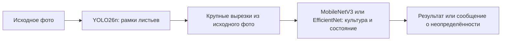

# Варианты повышения точности и смены архитектуры AgroVoice

Дата проверки источников: 4 октября 2026. Запрос Бориса: рассмотреть смену стека, отдельный поиск листа и определение заболевания, а также DETR. Это предложения и проект эксперимента. Новые модели в этой задаче не обучались, веса не скачивались, приложение и завершённая study10_v2 не менялись.

**Первый рекомендуемый эксперимент: YOLO26n для рамок + MobileNetV3-Large / EfficientNet-B0 для состояния отдельного листа. Второй: небольшой DETR, прежде всего DEIMv2-N или D-FINE-N. Третий: YOLO26s как более простой вариант одной модели.** Кандидаты должны победить на новых полевых данных и пройти телефон; выбор YOLO26n сейчас остаётся проверенной исходной линией, а не запретом менять архитектуру.

## 1. Что следует из наших результатов

Основное сравнение уже выполнено: по десять обучений YOLO11n и YOLO26n. YOLO26n лучше по среднему основной val, но это не делает все болезни хорошо различимыми. На реальном септориозе томата обе мобильные версии выдавали другие состояния. На огурцах есть путаница культуры, а классов огуречных болезней в модели нет.

Сверка Android-входов, выходов ONNX и NMS прошла. Поэтому неправильный томатный ответ нельзя просто списать на ошибку Android-интеграции. Возможные причины: слабое покрытие состояний, неоднозначная разметка, переход с лабораторного фона на поле, потеря деталей при уменьшении общего кадра, недостаточная специализация общего детектора. Их вклад ещё не измерен отдельно.

Наши данные размечают целый лист. Сегодня одна сеть одновременно локализует его, определяет культуру и состояние. Если она находит нужный лист, но неверно называет болезнь, это повод отдельно проверить классификацию крупной вырезки. Если лист вообще не найден, замена классификатора не поможет.

На общей val у здорового картофеля только один снимок, у клеща томата — тоже один. В test нет этих двух классов и огурца. Архитектуры нельзя устойчиво ранжировать по этим классам без новой контрольной выборки. Неизвестные болезни огурца нельзя получить одной сменой YOLO на DETR — нужны новые метки и обучение.

Численные основания: [все 20 запусков и все классы](02_MODEL_STUDY_2026-10-04.md), [ответы на реальных снимках](03_ANDROID_IMPLEMENTATION_2026-10-04.md).

## 2. Вариант A: детектор листа и отдельный классификатор

Это предлагаемая схема, пока не реализованная.

### Что делает первая модель

Нужно искать **все целевые листья**, в том числе здоровые и неопределённые. Схема «находим только больные, потом узнаём болезнь» создаёт опасную зависимость: не распознанный первой моделью больной лист вообще не попадёт на диагностику. Цель первой стадии — достаточная полнота поиска объектов, а не окончательный диагноз.

Для первого прототипа можно использовать геометрию текущей YOLO26n, игнорируя её предположение о болезни на второй стадии. Это позволит быстро проверить гипотезу. Затем отдельно сравнить обученный class-agnostic leaf detector или детектор культуры без заболевания. Если классы объединяются, создать новую производную выборку/manifest; замороженную v2 не редактировать.

Сборка класса «лист» из наших bbox не становится полноценной разметкой всех листьев мира. Исходные фотографии могут иметь неразмеченные фоновые листья, редкие культуры и неоднозначные границы; для отдельного детектора это нужно проверить. Изменится число каналов выхода и мобильный контракт — это новая модель, даже при том же имени YOLO26n.

### Что получает вторая модель

Вырезать найденный лист нужно из EXIF-ориентированного исходного/достаточно большого декодированного фото, **не из уменьшенного тензора YOLO 416×416**. Начальный исследовательский вариант — crop с небольшим запасом вокруг bbox, например 10–15%, вход классификатора 224/256; отдельно проверить 320/384. Запас и размер — предложенные параметры для сравнения, не уже выбранные значения.

Пример причины: лист занимает 15% ширины снимка. На общей картинке 416 его ширина около 62 пикселей. Вырезка того же листа из большого кадра может содержать значительно больше исходных деталей, которые можно передать отдельному классификатору. Выигрыш возможен, только если эти детали действительно есть в исходном файле; увеличение маленькой вырезки не восстанавливает информацию.

Диагноз может зависеть от рисунка пятен, краёв, жилок, обратной стороны листа и общего состояния растения. Поэтому чистая вырезка не гарантированно лучше: она может убрать полезный контекст или захватить второй лист. Нужны сравнение с/без запаса и сложные реальные примеры.

### С чего начать классификатор

У Torchvision MobileNetV3-Large имеет 5 483 032 параметра и около 0,22 GFLOPs, EfficientNet-B0 — 5 288 548 и около 0,39 GFLOPs в опубликованных конфигурациях ImageNet. Это характеристики исходных классификаторов, а не результаты AgroVoice или замеры Note 7. После замены головы/разрешения размеры и вычисления изменятся. [MobileNetV3-Large](https://docs.pytorch.org/vision/stable/models/generated/torchvision.models.mobilenet_v3_large.html), [EfficientNet-B0](https://docs.pytorch.org/vision/stable/models/generated/torchvision.models.efficientnet_b0.html).

Первый кандидат — MobileNetV3-Large как небольшая сравнительная сеть. EfficientNet-B0 — второй кандидат на тех же crop/split. При слишком тяжёлой работе рассмотреть MobileNetV3-Small; при нехватке качества — более крупный классификатор или учитель на ПК. Выбор Large/Small/B0 не фиксировать до собственного измерения.

Использовать transfer learning, обучая новую голову и затем размораживая часть/всю предобученную сеть по протоколу. Для первой серии достаточно общего классификатора существующих 30 меток. В следующей версии можно разделить культуру и состояние двумя головами или делать условный диагноз по известной культуре.

**Не обязательно держать три отдельные сети для картофеля/томата/огурца.** Общая извлекающая признаки сеть с несколькими головами может экономить память и использовать общие признаки. Это гипотеза для сравнения; три независимых модели тоже возможны, но увеличивают число файлов, стоимость обслуживания и потребность в данных.

Если пользователь выбрал культуру, эту информацию можно использовать в классификации вместо простого скрытия остальных рамок. Но принудительная выдача только томатных состояний для фотографии другого растения способна породить уверенную ошибку. Нужна проверка соответствия культуры и возможность неопределённого результата.

### Как готовить данные

Из существующих bbox можно получить классификационные вырезки с метками, но **сначала разделить исходные фотографии/растения на части, затем резать**. Все листья и варианты одного исходного кадра остаются в одной группе. Если нарезать, перемешать и потом разделить, соседние листья/фоны попадут одновременно в train и val и завысят оценку.

Классификационные новые архивы полезны для второй стадии, но их метки нужно проверить. PlantVillage можно использовать как дополнение, сохраняя отдельную полевую оценку. Рамки повреждённых участков WUR не равноценны вырезкам целого листа: для использования либо разметить лист, либо честно делать отдельный классификатор участков с иным контрактом.

Тренировать классификатор только на идеальных ground-truth crop недостаточно. Во время работы он увидит сдвинутые рамки детектора, поля, перекрытия и иногда неверный объект. Добавить контролируемые сдвиги crop и примеры предсказанных рамок, полученные без использования финального test. Предсказания детектора на его собственном train будут оптимистичнее рабочих: для реалистичных вырезок полезны отдельная train-only cross-validation или иной честный способ получения рамок.

### Цена двух стадий и проверка

Время = поиск листа + подготовка вырезок + классификация каждого выбранного листа + отображение. Если листьев десять, классификаций может быть десять. Число параметров не переводится напрямую в задержку телефона. Для режима «проверить один лист» пользователь может выбирать рамку, либо программа сначала обрабатывает наиболее подходящий объект по зафиксированному правилу; остальные не следует выдавать за уже диагностированные.

Преимущества предполагаемые: более крупные симптомы на входе, возможность обучать болезнь по классификационным данным, независимое улучшение локализации/диагноза. Недостатки: два вида ошибок, два экспорта, более сложное происхождение результата, дополнительная задержка. Пропущенный детектором лист не спасёт лучший классификатор.

Для диагностики ошибки сравнить классификатор на идеальных bbox и на реальных bbox YOLO. Это разделит проблему знания состояния и проблему первой стадии. Итог оценивать по всей цепочке, учитывая пропущенные листья и ложные рамки, а не только accuracy красивых готовых crop.

## 3. Вариант B: одна более крупная YOLO

Наиболее простой по коду эксперимент — YOLO26s вместо n на тех же данных, затем отдельный эксперимент с разрешением. В официальной COCO-таблице при 640 YOLO26n: 2,4 млн параметров/5,5 GFLOPs; YOLO26s: 9,5 млн/20,9 GFLOPs. Это около четырёхкратного увеличения параметров и вычислений в этих конфигурациях, а не четырёхкратная задержка Note 7. [Официальные конфигурации YOLO26](https://docs.ultralytics.com/models/yolo26/).

Преимущество — сохраняется единая задача детекции, существующая Android-интеграция требует меньше переделок. Более сильная сеть может лучше отделять похожие состояния; это ещё не измерено. Риск — переобучение на малой/неоднозначной выборке и дополнительная стоимость телефона. Отсутствующий класс огуречной болезни она тоже не выучит.

Вначале сравнить n и s на одинаковом входе 416. Увеличение до 512/640 делать отдельным условием с обучением/fine-tuning на соответствующем разрешении. Исторический запуск существующих весов при 512 без переобучения, давший худшую val, не исключает пользы правильно обученной высокодетальной версии. Все изменения нужно учитывать в бюджете вычислений.

Как альтернатива большей общей картинке возможны крупные вырезки/тайлы из фото. Они могут помочь мелким листьям, но требуют нескольких запусков детектора, объединения рамок и проверки частично обрезанных листьев. Для одного крупного листа проще сначала проверить классификационную вырезку.

## 4. Вариант C: DETR и небольшие современные варианты

DETR-семейство тоже решает поиск объектов с категориями. Замена головы детектора не является автоматически заменой болезни на более сильный самостоятельный диагноз. Его имеет смысл испытывать как альтернативу всей текущей детекции или первой стадии двухступенчатой схемы.

Для телефона нельзя выбирать только по названию Nano или FPS на NVIDIA. Размеры разных семейств различаются на порядок; серверный TensorRT-бенчмарк не равен Android CPU.

| Кандидат | Параметры из первичного источника | Роль в AgroVoice | Очерёдность |
|---|---:|---|---|
| DEIMv2-N | 3,6 млн | Небольшая современная DETR-линия для честного сравнения с YOLO26n | Один из первых DETR-кандидатов |
| DEIMv2-Pico | 1,5 млн | Вариант при приоритете компактности, проверить потерю качества | При необходимости меньшего бюджета |
| D-FINE-N | около 4 млн, округление авторского README | Другая небольшая DETR-линия; сравнительный контроль/резерв | После или вместо DEIMv2-N |
| RT-DETRv2-S | 20 млн | Более тяжёлый качественный контроль; потенциально учитель | После небольших вариантов |
| RF-DETR-Nano | 30,5 млн deployment-параметров в текущей таблице авторов | Сильная экспериментальная модель/учитель; мобильная пригодность измерить | Не первая замена для Note 7 |
| Исходный DETR | Отдельные ResNet-конфигурации | Исторический исследовательский baseline | Низкий приоритет практического прототипа |

DEIMv2-N/Pico имеют в авторской таблице около 6,8/5,2 GFLOPs, а репозиторий содержит экспорт ONNX и ONNX Runtime inference. Малые варианты используют HGNetv2; формулировка «DEIMv2 с DINOv3» не означает, что Pico/Nano несут большой DINOv3 ViT. Это опубликованные свойства, не результаты AgroVoice. [Авторы DEIMv2](https://github.com/Intellindust-AI-Lab/DEIMv2), [документация Transformers](https://huggingface.co/docs/transformers/model_doc/deimv2).

D-FINE-N опубликована как небольшой вариант DETR. Его заявленные GPU-тайминги не переносим на Redmi. Отдельные веса Objects365 имеют собственные условия данных; для первого опыта фиксировать конкретный checkpoint и его происхождение. [Авторы D-FINE](https://github.com/Peterande/D-FINE).

RT-DETRv2-S имеет в авторской COCO-таблице 20 млн параметров и около 60 GFLOPs при 640; предусмотрен ONNX Runtime deployment. Это аргумент начать с меньших моделей при ориентации на старый телефон, а не доказательство невозможности RT-DETR на Android. [Авторы RT-DETR/RT-DETRv2](https://github.com/lyuwenyu/RT-DETR).

RF-DETR Nano имеет 30,5 млн deployment-параметров при 384 в текущей таблице Roboflow; их быстрые задержки измерены на T4/TensorRT/FP16. В этом семействе Nano значительно больше YOLO26n по числу параметров. Около 122 МБ только для 30,5 млн float32-параметров — арифметическая оценка до графа/буферов, не измеренный размер ONNX или потребление RAM. [Авторы RF-DETR](https://github.com/roboflow/rf-detr).

Оригинальная DETR-реализация доступна как историческая линия, но для первого мобильного эксперимента предпочтительнее актуальные небольшие варианты. [Исходный DETR](https://github.com/facebookresearch/detr). Это рекомендация для нашего проекта, а не утверждение, что классический DETR всегда хуже.

### Что потребуется технически

DETR-граф нельзя подставить вместо `yolo26n.onnx` без изменения контракта. Потребуются собственные preprocess/postprocess, чтение иной формы выходов, порядок классов, численное сравнение и проверка координат. Некоторые реализации используют иную нормализацию/геометрию входа. Название «end-to-end» не отменяет прикладного фильтрации результатов и проверки контракта.

До длинной серии: проверить предобученную архитектуру на RX 9060 XT/ROCm — прямой проход, backward и шаг оптимизатора, затем ONNX FP32 и Android CPU. Репозитории могут ориентироваться на CUDA или конкретные экспортные операции. Наличие PyTorch/ONNX-скрипта не подтверждает полностью работоспособный путь на нашей AMD/Note 7.

Одинаковые seed и данные полезны, но принуждение всех моделей к одному неподходящему рецепту/60 эпохам может исказить сравнение. Для другого семейства зафиксировать рекомендуемый transfer-learning recipe и стоимость обучения; либо сравнивать в одинаковом вычислительном бюджете, либо отдельно указать различия. Не смешивать выбор лучшего рецепта с просмотром итогового test.

## 5. Вариант D: сегментация листа и/или поражений

Сегментация целого листа может убрать часть фона перед классификацией. Сегментация поражённой ткани может дать площадь симптомов. Это разные задачи и разные маски.

Схема: найти лист → получить маску листа → классифицировать исходную и/или замаскированную вырезку. Нужна проверка, что маска не вырезает именно болезнь, сильно деформированный край или полезный контекст. Чёрный фон маски тоже может стать искусственным признаком; обучать/проверять в сопоставимых условиях.

Для доли видимого поражения понадобятся минимум маска листа и маска повреждённых частей; отношение площадей не устанавливает патоген и не обязательно равно агрономической тяжести. Текущие целолистовые PlantDoc-bbox этой задачи не решают. Кандидат PlantSeg уже есть в каталоге данных, но происхождение/классы/пересечения нужно проверять отдельно.

Это разумный более поздний этап, когда появится проверенная масочная разметка или явно выявленная проблема фона. Установка сегментационной модели без подходящих масок не создаст обученную систему.

## 6. Вариант E: сильный учитель на компьютере, компактная сеть на телефоне

Можно обучить более сильный классификатор или детектор для исследовательской оценки на ПК, затем передавать его выходы/признаки меньшему ученику вместе с истинной разметкой. Это knowledge distillation: она позволяет исследовать более сложного учителя без обязательного переноса его вычислений на телефон. [Исходная работа о дистилляции](https://arxiv.org/abs/1503.02531).

Практическая линия: более крупный классификатор на вырезках → MobileNet/EfficientNet ученик; либо большой детектор → небольшой детектор. Учитель должен сначала показать преимущество на корректной полевой val. Если он повторяет ошибки/смещение PlantVillage, ученик может их унаследовать. Псевдометки не считаются экспертными диагнозами.

В отсутствие подробных disease-меток можно исследовать предобученные визуальные признаки, обучение головы и дообучение; эффект нужно измерить. Самостоятельная установка общего визуального/языкового ИИ на телефон не заменяет обученный и проверенный диагностический классификатор.

Учитель и ensemble удобны для ПК, где допустима дополнительная стоимость. В телефонный основной режим сначала стоит переносить лучший одинарный/двухступенчатый компактный вариант, а не всегда исполнять YOLO11+YOLO26+DETR одновременно. При нерешённой неоднозначности можно исследовать выборочный второй прогон, учитывая дополнительную задержку и ограничения confidence.

## 7. Что улучшать независимо от архитектуры

### Полевые данные и честные метки

В наших данных простой лабораторный auxiliary даёт очень высокие метрики при заметно меньшем основном val. Нужны реальная съёмка, листья разных растений, стадии симптомов, фон и освещение. Похожие проблемы переноса описаны и в исходной работе PlantVillage: качество на внешних фотографиях существенно отличалось от оценки внутри набора. Это пример другого исследования, а не прогноз процента AgroVoice. [Mohanty, Hughes, Salathé](https://arxiv.org/abs/1604.03169).

Добавлять не только больные, но и здоровые/неопределённые листья, дефициты питания и другие причины похожих симптомов. Отбирать редкие ошибки модели, проверять диагноз и включать в train; финальный test для этого не использовать. Приоритет новых источников уже описан в [плане данных](04_DATA_AND_ROADMAP_2026-10-04.md).

### Баланс и рецепт обучения

Сравнить умеренное выравнивание редких классов/групп, взвешенную loss или sampler для классификатора. Бесконечное повторение одного листа не создаёт разнообразия и может переобучить сеть. Аугментации должны сохранять признаки: сильная смена цвета способна уничтожить диагностическое пожелтение/окраску, большой crop — вырезать очаг. Проверять эффекты отдельно, не включать десяток изменений одним пакетом.

### Неопределённость и качество снимка

Нужны понятные ответы «не удалось определить», «лист слишком мелкий», «снимок размытый/тёмный», предложение переснять или выбрать лист. Эти механизмы прежде всего снижают количество вводящих в заблуждение ответов; они не равны повышению AP/accuracy всех кадров. Оценивать и долю отказов, и ошибку среди оставшихся ответов.

Порог softmax, разница top-1/top-2 и temperature calibration на val могут служить исходными способами отбора уверенных ответов, но не гарантируют выявления неизвестной болезни. Нужны контрольные нетипичные/нецелевые примеры и явно определённый протокол отказа. Общую цифру confidence не объявлять вероятностью истинного диагноза.

### Съёмка

Для первого полевого режима полезнее хорошо сфокусированный один лист, чем общий кадр грядки с маленькими объектами. Сохранять оригинал, показывать выбранную рамку, при необходимости просить ближе/обратную сторону. Некоторые диагнозы по одному фото принципиально неоднозначны; модель должна показывать гипотезу и ограничения, а не автоматически назначать препараты.

## 8. Какой эксперимент предлагается первым

Не запускать десять длинных обучений всех найденных архитектур без предварительного отбора. Предлагается следующая последовательность:

1. **Заморозить новую полевую development-выборку** с приоритетными культурами и корректными метками; сохранить отдельную финальную часть. Группировать по исходному растению/серии/источнику до нарезки. Пока нет новых данных, существующая val может служить техническому пилоту с явными ограничениями.
2. **Разделить ошибку локализации и состояния.** Проверить рамки без учёта класса, classifier на GT-crop и detector-crop. Это отвечает, какая стадия ограничивает итог.
3. **Проверить четыре основные линии:** текущая YOLO26n; YOLO26n + MobileNetV3-Large; YOLO26n + EfficientNet-B0; один небольшой DETR, например DEIMv2-N. YOLO26s добавить как практический одноступенчатый контроль, D-FINE-N — резерв/расширение.
4. **Ранний отсев по экспорту и телефону.** До затрат на полное обучение проверить forward/backward/ONNX/Android, затем измерить хотя бы базовую стоимость вычислений с выбранным размером. Предобученный COCO-граф здесь тестирует исполнение, не болезнь.
5. **Разведочный этап, например три seed**, допустим только как пилот для отбора гипотез. Не объявлять по нему итоговую победу. Финалисты — **десять независимых обучений каждого варианта**, согласно принятому требованию Бориса; сообщить, что выбор финалистов по development тоже влияет на оптимизм.
6. **Оценить общий конвейер и ограничения.** Для классификации: macro-F1, per-class precision/recall, confusion matrix; для рамок: AP/recall; для итоговой системы: общая class-aware оценка и число пропущенных/ложных/неопределённых листьев. Метрики классификации и mAP нельзя напрямую сравнивать как одну цифру.
7. **На телефоне измерить весь сценарий**: холодная загрузка, декодирование, поиск, crop, классификация одного/нескольких листьев, отрисовка; память и длительные повторы. Итоговая скорость не равна времени одного классификационного графа.
8. **После выбора** выполнить один заранее определённый финальный test и внедрить победивший вариант в APK с актуальным происхождением и численным паритетом.

При сравнении двух стадий с YOLO class-aware AP можно считать по её финальным рамкам и диагнозам. Правило оценки уверенности/объединения выходов фиксировать на development; произведение двух сырых confidence не считается автоматически калиброванной вероятностью. Приказ «покажи accuracy классификатора» не освобождает от отчёта о пропусках первой стадии.

## 9. Что менять в Android, если выигрывают две модели

Не требуется сразу менять Kotlin/Compose, FileProvider, Photo Picker или формат сохранения исходных фотографий. Изменяется ML-часть: детекторный и классификационный контракты, crop, preprocessing каждой модели, состояние загрузки и происхождение результата. Сохранять SHA обоих графов, version/taxonomy и ID листа.

Один leaf detector + один общий classifier — предпочтительная стартовая реализация по простоте. Две одновременно открытые небольшие сессии могут ускорить повторные листы, но увеличат RAM; последовательное открытие экономит часть памяти с ценой загрузки. Это решение принять после измерений Note 7/A56, а не по размеру файлов.

Пользователь должен видеть, какая рамка анализируется и что ответ может быть неопределённым. Переключатель текущих YOLO остаётся сравнением прежнего подхода; новый режим лучше явно назвать по схеме, чтобы не приписать диагноз классификатора только YOLO26n.

## 10. Рекомендуемый порядок и статус решения

| Приоритет | Вариант | Почему |
|---|---|---|
| 1 | YOLO26n + MobileNetV3-Large; рядом EfficientNet-B0 | Проверяет конкретную гипотезу: больше деталей листа и отдельная задача состояния |
| 2 | DEIMv2-N или D-FINE-N | Даёт содержательное сравнение с другой небольшой детекторной архитектурой |
| 3 | YOLO26s | Простая проверка, ограничена ли текущая сеть ёмкостью |
| 4 | Новый полевой train/holdout, crop/разметка/баланс | Необходимы для всех линий; это не шаг, который откладывается до конца |
| 5 | Сегментация, учитель/дистилляция, выборочный ensemble | После определения фактического ограничения и наличия нужных меток |

Приоритет эксперимента не означает доказанный прирост. **Мой предпочтительный кандидат на следующий стек — YOLO26n + отдельный лёгкий классификатор, с небольшим DETR в сравнении.** Финальный выбор зависит от качества на новых полевых данных и реальной стоимости телефона. Само наличие трансформера, слова Nano или двух моделей не является доказательством точности.

Исходные результаты и текущая рекомендованная YOLO26n сохраняются как baseline. Обучение новых вариантов, установка зависимостей, изменения классов и APK в этом запросе не выполнялись. [Содержание отчётов](README.md), [журнал](../../PROJECT_GUIDE.md).
