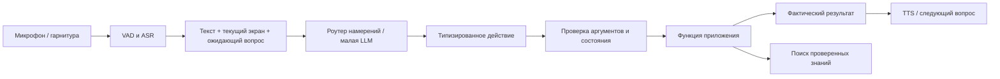

# Свободное голосовое управление и локальный агрономический помощник

Проверено по коду и первоисточникам 19.10.2026. Модели ниже не скачивались и не дообучались в этой задаче; скорость и русский язык на целевых телефонах ещё не измерены. [Общий отчёт](../PROJECT_REPORT_2026-10-19.md), [зрение](ROBUST_VISION_2026-10-19.md), [источники знаний](AGRONOMY_LIBRARY_2026-10-19.md).

## 1. Что именно строим

Человек говорит: «Сними этот лист, скажи, что с ним, и запиши в участок у теплицы». Приложение понимает последовательность намерений, уточняет неоднозначность, снимает, получает результат от визуальной модели, озвучивает его и сохраняет осмотр. «Что можно сделать?» запускает поиск проверенных мер для текущего осмотра. «Нет, не сохраняй» отменяет ожидающее действие. Пользователь не должен помнить точную формулировку команды.

Система состоит из распознавания речи, понимания команды, управления состоянием приложения, поиска знаний и синтеза речи. Одна LLM не заменяет эти части. Визуальная модель не становится точнее от того, что LLM красиво пересказывает её ошибку.

**Граница обещания:** полный цикл без касания внутри уже запущенного приложения реалистичен. Первый запуск, выдача Android-разрешений, разблокировка телефона и работа при выключенном экране — отдельные системные сценарии, зависящие от ОС и устройства. Локальная LLM сама не получает права управлять всем смартфоном. В MVP используем прямые функции AgroVoice, а не координатные нажатия или AccessibilityService.

Voice Access — полезный образец управления и доступности, но не готовое русское решение: в прочитанной [официальной справке](https://support.google.com/accessibility/android/answer/6151848?hl=ru) русский отсутствует в списке поддерживаемых языков. Русский перевод страницы не доказывает поддержку русской речи. TalkBack читает интерфейс и помогает навигации; это другой компонент, не интерпретатор произвольных поручений.

## 2. Что есть сейчас

- [OfflineVoiceController](../../android-app/app/src/main/java/com/agronomy/phytomonitor/voice/OfflineVoiceController.kt): Vosk, грамматики команд; свободная диктовка заметки при `grammar = null`; жизненный цикл микрофона.
- [VoiceCommands](../../android-app/app/src/main/java/com/agronomy/phytomonitor/voice/VoiceCommands.kt): нормализация и фиксированные правила, команды по экрану. Уверенность ASR используется при принятии команды; это не качество понимания намерения.
- [FieldDemoActivity](../../android-app/app/src/main/java/com/agronomy/phytomonitor/FieldDemoActivity.kt): исполнение команд, переключение экранов, повторное слушание; остановка микрофона в `onStop`.
- [OfflineResultSpeaker](../../android-app/app/src/main/java/com/agronomy/phytomonitor/voice/OfflineResultSpeaker.kt): установленный системный русский TTS, только голоса без требования сети. Голос в APK не встроен.

LLM-runtime, контекстный инструментальный диспетчер, retrieval и агрономическая база отсутствуют. Непрерывный режим распознавания уже существует, поэтому его не нужно объявлять полностью новой функцией. Но он не равен свободному диалогу, постоянно доступному wake word или гарантированной работе без рук.

## 3. Кандидаты LLM

Размеры в именах — характеристики авторов, не замеры RAM. «Русский поддержан» означает заявление источника, не доказательство корректного понимания агрономических команд.

| Кандидат и первоисточник | Русский и назначение | Условия и ограничения | Роль в проверке |
|---|---|---|---|
| [Qwen3-0.6B](https://huggingface.co/Qwen/Qwen3-0.6B) | Русский входит в [список языков Qwen3](https://qwenlm.github.io/blog/qwen3/); инструкции и tool use | Apache-2.0; отключать thinking для коротких команд; маленькая модель ошибается в многошаговых запросах | **Первый воспроизводимый baseline команд** |
| [Qwen3-1.7B](https://huggingface.co/Qwen/Qwen3-1.7B) | Та же многоязычная линия; кандидат для диалога с контекстом | Больше весов, KV-cache и времени; качество не гарантируется одним размером | Второй кандидат, особенно для A56 |
| [Qwen3.5-0.8B](https://huggingface.co/Qwen/Qwen3.5-0.8B), [2B](https://huggingface.co/Qwen/Qwen3.5-2B) | Актуальная мультимодальная линия, широкая многоязычность; собственный тест русского обязателен | Apache-2.0; hybrid DeltaNet/attention, отдельная проверка поддержки выбранным runtime; visual encoder дополнительно занимает память; 0.8B по карточке предназначен для прототипов и специального дообучения | **Современный challenger**; сначала только текст, затем отдельный опыт с изображением |
| [Qwen2.5-0.5B-Instruct](https://huggingface.co/Qwen/Qwen2.5-0.5B-Instruct) | В карточке прямо указан русский и структурированные ответы | Apache-2.0 именно этого checkpoint; меньше и проще, но более ранняя модель | Дешёвый контроль и запасной вариант |
| [FunctionGemma 270M](https://ai.google.dev/gemma/docs/functiongemma) | Специализированный перевод текста в вызовы функций; автор требует адаптации к своим функциям | Gemma terms, не автоматически Apache; карточка не подтверждает качество русского tool use; не предназначена для обычного диалога | **Самый интересный малый роутер после русского SFT**, не генератор агрономических советов |
| [Gemma 3 270M / 1B](https://ai.google.dev/gemma/docs/core/model_card_3) | Компактные текстовые варианты; широкая языковая поддержка семейства не доказывает одинаковое качество малых размеров | Gemma terms; публичные raw-карточки HF вернули 401, использована документация Google | Резерв: сначала probe русского и сравнение с Qwen |
| [Gemma 4 E2B](https://ai.google.dev/gemma/docs/core/model_card_4) | Мультимодальность, function calling, многоязычность; ориентирована на edge | В текущей карточке Apache-2.0. E означает **effective**, не размер всех весов: у E2B указано 2.3B effective и 5.1B с embeddings. Требования к A56 надо измерять | Возможный расширенный профиль; не считать автоматически легче Qwen 2B |
| [SmolLM3-3B](https://huggingface.co/HuggingFaceTB/SmolLM3-3B) | Русский явно в metadata; многоязычность и вызовы инструментов | Apache-2.0; больший объём, не первый кандидат для Note 7 | Контроль более сильной модели на арендованной машине/A56 |
| [LFM2-350M/700M/1.2B](https://huggingface.co/LiquidAI/LFM2-1.2B), [LFM2.5-1.2B-Instruct](https://huggingface.co/LiquidAI/LFM2.5-1.2B-Instruct) | Гибридные модели для устройств; в прочитанных списках языков **русского нет** | Собственная LFM Open License; результаты CPU производителя нельзя переносить на наш аппарат | Малые 350M/700M допустимы как опыт русификации узкого роутера. Не основной путь: придётся доказывать пользу языковой адаптации |

Название «русская модель» на HF и готовый GGUF от третьего лица недостаточны: проверять исходный checkpoint, лицензию, ревизию, tokenizer/chat template, происхождение квантизации и отсутствие потери качества после неё. Сравнивать instruction/post-trained варианты, а не случайно Base с Instruct. По карточкам нельзя назвать окончательного победителя.

Уточнение последующего поиска: у **LFM2.5-2.6B** русский уже указан в карточке;
ограничение строки выше относится к перечисленным малым версиям, не всему семейству.
Подготовленные корпуса, GigaAM как дополнительный ASR-кандидат и актуальный отбор —
[данные и модели для обучения](DATA_AND_MODEL_SELECTION_2026-10-19.md).

### Память и бюджет

Теоретический нижний объём одних весов равен `число параметров × число бит / 8`. Это **расчёт**, не расход памяти процесса. Добавляются scales, неквантизованные тензоры, KV-cache, рабочие буферы, tokenizer, ASR, изображение, визуальная модель и Compose. У моделей с effective parameters считать полный объём, а у VLM — ещё image encoder/projector.

Начать с Q4-варианта компактной модели, короткого контекста состояния и ограниченного ответа. Не использовать максимальное окно из рекламы. Сравнить Q4 с более точной квантизацией на русских командах: экономия RAM может испортить отрицания и числовые слоты. Конкретные пределы RAM, p95 и размер загрузки определить по фактическим конфигурациям Note 7/A56 и замерам; они пока неизвестны. Расценки аренды не исследованы и не включены в обещания.

## 4. Runtime, ASR и TTS

| Компонент | Практический выбор | Проверка перед внедрением |
|---|---|---|
| LLM-runtime | [llama.cpp Android](https://github.com/ggml-org/llama.cpp/blob/master/docs/android.md): GGUF, JNI/NDK, CPU baseline | Конкретный commit с поддержкой выбранного Qwen; отмена генерации, lifecycle, память и лицензии |
| Альтернативный runtime | [LiteRT-LM](https://github.com/google-ai-edge/LiteRT-LM): Kotlin API и on-device tool use | Поддерживаемые модели и конвертация; реальная GPU/NPU-поддержка на каждом телефоне. Наличие NPU не означает совместимость графа |
| Формат вызовов | [llama.cpp GBNF/JSON Schema](https://github.com/ggml-org/llama.cpp/blob/master/grammars/README.md) либо штатный template модели | Грамматика гарантирует форму, не правильность аргументов и намерения |
| ASR первый шаг | Существующий Vosk без закрытой грамматики в диалоговом режиме | Проверить естественные русские фразы и агрономические названия, не только список команд |
| ASR сравнение | [sherpa-onnx](https://k2-fsa.github.io/sherpa/onnx/index.html), [whisper.cpp](https://github.com/ggml-org/whisper.cpp) с многоязычным Whisper | Модель должна поддерживать русский; `.en` не подходит. WER, шум, false activation и расход батареи измеряются отдельно |
| ASR резерв | [Qwen3-ASR-0.6B](https://huggingface.co/Qwen/Qwen3-ASR-0.6B) | Русский заявлен, но Android-runtime и ресурсная цена здесь не проверены; для слабого телефона не исходный вариант |
| TTS | Системный офлайн-голос сейчас; затем sherpa-onnx с русским голосом подходящей лицензии | Проверять лицензию **голосовых весов**, возможность прерывания и офлайн-работу после чистой установки |

Первый вариант — раздельные ASR → текстовая LLM → TTS: проще измерять ошибки каждого этапа и переиспользовать код. Мультимодальная модель со звуком — исследовательская альтернатива, а не требование для MVP. Одновременное распознавание и собственная озвучка требуют audio focus/эхоподавления; для первого рабочего режима — остановка ASR на время TTS и явное возобновление. Прерывание голосом добавлять с отдельной проверкой эха.

## 5. Как LLM управляет приложением



LLM выдаёт предложение действия. Исполнитель в Kotlin проверяет разрешённый тип, текущий экран, существование осмотра/участка, завершённость анализа и права. Он не исполняет произвольный код или текст как команду. Модель получает компактное состояние, а не весь журнал и не скриншоты интерфейса.

Пример **целевого протокола**, ещё не реализованного:

```json
{"action":"save_inspection","arguments":{"inspection_id":"current","plot_name":"У теплицы"}}
```

Для отсутствующего или неоднозначного участка нужен вопрос «Создать участок “У теплицы” или выбрать существующий?». Список действий: открыть камеру/галерею/журнал, снять, анализировать, прочитать результат, добавить заметку, выбрать участок, сохранить, отменить, найти рекомендации. Многошаговое поручение превращается в очередь проверяемых действий; следующий шаг стартует после успешного завершения предыдущего, а не по выдуманному LLM сообщению «готово».

Сохранение выполняется однократно при повторном ASR-final. Отмена, «стоп», таймаут и переход приложения в фон обрабатываются независимо от генерации. Удаление и другие необратимые действия требуют отдельного голосового подтверждения с указанием объекта. Для записи диктуемого текста нужен отдельный режим: фраза внутри заметки «удали старые листья» не является командой удаления журнала.

Доступность: озвучивать текущий экран, успех/ошибку и доступные продолжения; сообщать качество наведения, использовать звук начала/конца записи; поддержать гарнитуру, TalkBack, крупный текст и запасные кнопки. Протокол полного цикла проверять с людьми, включая сценарии без взгляда на экран. Для фото отсутствие рук не устраняет необходимость навести камеру: голосовые подсказки положения/размера листа — отдельная открытая задача.

## 6. Дообучение: что и на чём

Дообучение нужно проверить экспериментом. Если исходная модель с хорошими примерами уже решает сценарии, SFT всё равно сравнивается с ней, а не объявляется улучшением заранее. Для FunctionGemma специальное дообучение прямо предусмотрено авторами.

**Два разных корпуса:**

1. **Управление.** Реальная русская фраза + состояние экрана + предыдущий вопрос → действие, аргументы или уточнение. Разговорные синонимы, падежи, отрицания, исправления, паузы, названия участков, номера, несколько действий, просьбы вне возможностей приложения. Синтетические перефразировки — только дополнение, затем проверка человеком и настоящие ошибки ASR.
2. **Ответы по источникам.** Вопрос + найденные проверенные фрагменты → короткий ответ с source_id, либо отказ из-за отсутствия данных/конфликта/неверного региона. Фактическую рекомендацию подтверждает специалист. Не использовать сгенерированные моделью дозировки как обучающую истину.

Разделение train/val/test по авторам фраз, шаблонам сценариев, документам и говорящим; перестановка слов одной фразы не создаёт независимого test. Сначала ручной небольшой покрывающий набор всех функций и ошибок, потом расширение по журналу неудач с согласия участников.

Обучение — LoRA/QLoRA на арендованной GPU в отдельном комплекте. Сохранять конфиг, исходную модель и revision, версии библиотек, параметры адаптера, dataset split, метрики. Сначала SFT действий; для очень маленьких FunctionGemma/LFM сравнить с полным дообучением, если LoRA недостаточно. Обучать русский с нуля нерационально при наличии Qwen; языковая адаптация лёгкой модели имеет смысл только при измеренном выигрыше по памяти/скорости и сохранённом качестве русского. Продолженное предобучение на книгах не заменяет SFT вызовов функций.

После обучения: merge/экспорт при необходимости, квантизация, повтор всей проверки на артефакте для телефона. Преимущество FP16 на GPU не равно преимуществу Q4 на Android. Изображения и диагнозы для vision fine-tuning — отдельный корпус с экспертными метками, не текстовые учебники.

## 7. Знания: база с поиском важнее запоминания дозировок

Справочник содержит актуальные структурированные карточки культуры, состояния, агротехники и зарегистрированных применений. Поиск сначала фильтрует культуру, диагноз, регион BY, статус `verified`, дату действия и категорию применения. Далее lexical/BM25-поиск; [multilingual-e5-small](https://huggingface.co/intfloat/multilingual-e5-small) — дополнительный семантический кандидат, если он даст пользу. Отдельная embedding-модель не обязательна для маленькой базы; SQLite FTS и словарь синонимов могут быть достаточны.

LLM формулирует ответ **из найденных карточек**, а числа препарата, нормы, сроки ожидания и ограничения выводятся детерминированно из проверенных полей. Даже правильная цитата не разрешает применение на другой культуре или в другой стране. При нескольких гипотезах диагноза нельзя выбрать химическое лечение по одной удобной гипотезе. До верификации карточки — `draft`, без исполнительных рекомендаций. Пустой поиск → «нет проверенной рекомендации», без дополнения из памяти модели.

Текст книги и retrieved-фрагменты — данные, не инструкции исполнительному диспетчеру. Ответ справочника не может запускать удаление, экспорт или изменение состояния. Источник и редакция хранятся в журнале вместе с показанной рекомендацией, чтобы она оставалась воспроизводимой после обновления базы.

## 8. Измерение и следующий рабочий инкремент

| Проверка | Что измеряем |
|---|---|
| Только текст | Правильное действие и все слоты; ненужные уточнения; пропущенные отрицания; недопустимые действия |
| Голос → действие | Завершение сценария целиком; WER как вспомогательное измерение; тишина/теплица/ветер/гарнитура; разные говорящие |
| Диалог | Ссылка «этот снимок», исправление участка, отмена посреди анализа, повтор ASR-final, перезапуск приложения |
| Справка | Релевантность retrieval, соответствие цитате, отсутствие выдуманных препаратов/чисел, верный отказ при неизвестном диагнозе |
| Телефон | Холодный запуск, p50/p95 до действия/озвучки, память, батарея, нагрев, offline после перезагрузки |

**Предложенные условия приёмки:** на фиксированном тесте нет запрещённых действий и исполнения отрицательных команд; все критические сценарии можно закончить голосом; каждый совет ссылается на действующую проверенную карточку. Эти условия ещё не достигнуты. Процент успешности обычных команд и допустимую задержку зафиксировать после первого baseline и пользовательской проверки; рекламные числа сюда не переносить.

Следующий отдельный инкремент **V-06**: вынести типизированные действия из Activity в общий исполнитель для кнопок и голоса; создать тестовый корпус русских намерений; сравнить текущие правила, компактный intent/slot-классификатор без LLM, Qwen3-0.6B и Qwen3.5-0.8B. **V-07**: русский SFT FunctionGemma/Qwen для проигрываемых сценариев и Android-прототип. **V-08**: полный hands-free цикл с гарнитурой и доступностью. **K-04**: verified retrieval и ответы с источниками после K-01/K-02. Это дополнения к V-01…V-05, а не утверждение, что существующие карточки уже закрыты.
