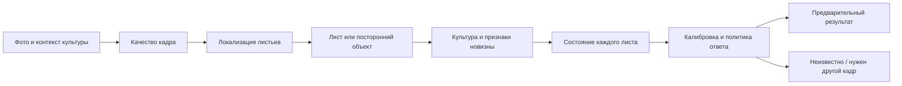

# Надёжное распознавание растений: варианты за пределами YOLO

Дата проверки источников: 19.10.2026. Это исследование и постановка экспериментов, не результат обучения новых моделей. Связанные документы: [состояние проекта](../PROJECT_REPORT_2026-10-19.md), [голос и локальная LLM](LOCAL_ASSISTANT_2026-10-19.md), [литература](AGRONOMY_LIBRARY_2026-10-19.md).

## 1. Точная постановка

Нужна автономная система, которая на обычной фотографии находит лист, определяет поддерживаемую культуру, оценивает видимые признаки и умеет отказаться от ненадёжного заключения. Она должна сохранять результат при допустимых изменениях освещения, различать неизвестное растение и известную болезнь, запрашивать дополнительный кадр, а не подгонять всё под имеющиеся классы.

Под «пониманием» здесь подразумеваем проверяемое поведение: согласованность между кадрами, использование формы и структуры листа, различение фона и объекта, сохранение неопределённости и правильный выбор следующего действия. Разговорное объяснение LLM само по себе этого не доказывает. По одному виду листа нельзя гарантированно отличить все инфекции, дефициты, ожоги и совместные поражения: иногда нужен осмотр всего растения, оборотной стороны листа, история условий или лабораторный анализ.

Ограничения: Android без сети, Note 7 как слабый целевой аппарат, A56 как второй профиль; обучение на арендованной GPU; существующий порядок taxonomy_v1 сохраняется. Новые классы — в отдельной версии. Бюджет аренды и допустимое время ответа не заданы: ниже порядок экспериментов, без обещаний стоимости и миллисекунд.

## 2. Почему возникают ошибки

| Наблюдение пользователя | Возможная причина, которую нужно проверить | Что проверять и менять |
|---|---|---|
| Стол → «ожог кукурузы» | Нет достаточно разнообразных негативов; модель видит похожую текстуру, детектор присваивает один из известных классов | Отдельный набор нерастительных сцен; негативы с пустой детекторной разметкой; проверка наличия листа; отказ по новизне |
| Чужое растение → персик | Закрытый набор культур, нет задачи определения неизвестного вида | Unknown-crop тест с целыми исключёнными видами; признаки формы листа; проверка согласованности культуры и состояния |
| Тень → болезнь | Лабораторное смещение, признаки цвета/фона вместо симптомов | Парные реальные кадры в тени и на свету; умеренные фотометрические преобразования; полевые данные |
| Уверенная неверная подпись | Score не калиброван и не измеряет незнание | Калибровка на отдельной val; risk–coverage; OOD-примеры, отдельные пороги по задачам |
| Хорошая вырезка, плохое фото целиком | Ошибка локализации, потеря листьев, обрезка симптомов | Проверка всей цепочки от полного кадра, не только классификации идеальных вырезок |

Это гипотезы, а не установленный диагноз конкретных ошибок: сами проблемные фотографии здесь не исследовались. Неясное название «альфария» не превращаем в метку вида: снимок и подтверждённое название нужны при формировании теста.

Уже в исходной работе PlantVillage показана проблема переноса из контролируемых условий на другие изображения [V1]. Результат на лабораторной выборке нельзя считать точностью в теплице. Добавление слов «не знаю» в промпт не исправляет детектор.

## 3. Что уже пробовали в AgroVoice

В [манифесте APK](../../android-app/app/src/main/assets/models/manifest.json) есть YOLO11n, YOLO26n/s/m, DEIMv2-N и двухэтапные варианты с MobileNetV3-Large, EfficientNet-B0, маской листа и дистилляцией. Они используют старую таксономию, а не allcrops.

Первичные результаты: [полная цепочка accuracy_v1](../experiments/accuracy_v1/pipeline/), [финальный тест выбранной S](../experiments/yolo26s_focus_v1/final_test/yolo26s_test.json). В прежнем пилоте классификатор на вырезках не дал автоматического улучшения полной цепочки; некоторые режимы уменьшали число лишних ответов ценой пропусков. Нельзя объявить двухэтапный подход победителем только потому, что он архитектурно привлекательнее. И нельзя отвергать всё семейство DETR по одному прежнему DEIM-пилоту с иным рецептом обучения.

Исторические ограничения: [пересечения данных](../experiments/yolo26s_data_v1/HISTORICAL_OVERLAP_ADDENDUM_2026-10-05.md), неполное число повторов у альтернатив, неодинаковые критерии выбора checkpoint. Старые скрипты переиспользуем как справку; новую проверку организуем отдельным ограниченным экспериментом, не возобновляем старые бесконечные очереди.

## 4. Сравнение архитектур

Публичные COCO-рекорды не ранжируют диагнозы растений. Время TensorRT на серверной GPU не описывает Android CPU. В таблице — пригодность к проверке, а не измеренное качество AgroVoice.

| Семейство | Возможный выигрыш | Ограничения / ресурсы / лицензия | Решение |
|---|---|---|---|
| YOLO26n/s + исправленные данные | Готовый runtime, дешёвый контроль эффекта негативов и полевых данных | Закрытый набор классов; текущий score не решает OOD; Ultralytics AGPL-3.0 | Обязательная исходная линия сравнения |
| **D-FINE-N/S** [V2] | DETR с уточнением распределений рамок; независимая от YOLO детекторная линия | Android-операторы и память проверить; Apache-2.0 кода не снимает ограничения checkpoint на Objects365 | Первый новый детектор; начать с COCO-весов с проверенными условиями |
| **RT-DETR / RT-DETRv2** [V3] | Зрелая transformer-альтернатива, обучение без обычного NMS; есть ссылка автора на сторонний Android-пример | Цена attention и постобработки зависит от экспорта; чужой пример на Pixel не подтверждает Note 7 | Запасной кандидат, если D-FINE не проходит экспорт/скорость |
| **RF-DETR** [V4] | Предобученный визуальный backbone, детекция и сегментация; перенос на свой набор | Варианты даже с названием Nano могут быть существенно тяжелее привычного N; выбирать конкретную модель и лицензию, проверять весь граф | Кандидат на арендованной GPU и сильном телефоне; не первый для Note 7 |
| Локализатор листа + **MobileNetV3 / EfficientNet** | Разделение наличия листа, культуры и состояния; можно обучать на вырезках | Ошибка первого этапа необратима; стоимость растёт с числом листьев; старый пилот уже показывал этот компромисс | Проверять обновлённый классификатор на реальных предсказанных вырезках |
| **DINOv2 ViT-S / DINOv3** + классификационная голова [V5,V6] | Богатые предобученные признаки; можно начать с замороженного backbone и линейной головы, без полного дорогого обучения | Это не готовый диагноз и не готовый OOD-детектор. DINOv2 основной — Apache-2.0; DINOv3 — собственная лицензия; специализированные добавления к DINOv2 имеют иные условия | DINOv2 как учитель и контроль качества представления; затем дистилляция в мобильную сеть |
| **MobileCLIP / MobileCLIP2** [V7] | Семантические признаки и сравнение с текстовыми описаниями, полезные для широких категорий | Сходство с текстом не вероятность болезни; открытый словарь не гарантирует unknown rejection; у моделей Apple отдельные TOU | Дополнительная гипотеза для «растение/предмет/неизвестное», не единственный диагност |
| **SAM 2 / компактный сегментатор** [V8] | Маска листа может убрать фон; помощь разметчику | SAM не назначает болезнь. Маска способна срезать важный край; дополнительная память и вычисления | Прежде всего инструмент разметки/учитель; мобильную маску проверять отдельной абляцией |
| **Qwen3.5-0.8B/2B, Gemma 4 E2B** [V9,V10] | Изображение + вопросы пользователя, общая сцена, возможность запросить дополнительный ракурс | VLM может уверенно выдумывать; специальной проверки фитопатологии нет; visual encoder, токены изображения и память | Исследовательский кандидат для общей сцены и диалога. Не подменять им проверенный диагноз |

RF-DETR README проверен в ветке `develop`: адрес `main` возвращал 404. DINOv2 README сейчас содержит отдельные XRay/Cell-DINO: их ограничения нельзя смешивать с исходным DINOv2. В D-FINE авторы отдельно предупреждают об условиях Objects365. DEIMv2 остаётся только локальным историческим экспериментом по правилам проекта.

### Рекомендуемая схема

Это логические задачи, не требование держать столько сетей в RAM. Один backbone с несколькими головами может оказаться выгоднее каскада. Сравнить оба варианта. Для сильного телефона возможен дополнительный анализ по запросу; для слабого — один компактный проход. Функции речи и зрения по возможности исполнять последовательно, чтобы уменьшить пиковую память.

Не вводить жёсткий автоматический фильтр культуры до проверки: ошибка «культура = персик» иначе запретит правильный ответ второго этапа. Выбор культуры человеком — дополнительный контекст; противоречие с изображением должно вызывать уточнение. Ограничение списка классов само по себе не увеличивает достоверность.

## 5. Что даст больше шансов на точность

1. **Отрицательные примеры.** Столы разных цветов, дерево, бумага, ткань, руки, почва, инструменты, еда, экраны; отдельно неизвестные растения, цветы, плоды и больные состояния вне taxonomy. Неподдерживаемый лист нельзя размечать как «не растение». Для детектора «лист» он положительный, для классификатора поддерживаемых культур — unknown. Внешние OOD-источники не должны совпадать с конечным OOD-test.
2. **Полевое разнообразие.** Другие хозяйства, сорта, телефоны, стадии заболевания, сезон и свет. Разделять по растению/серии/месту съёмки; все почти-дубликаты и преобразования держать в одном split. Зафиксировать новый собственный test до обучения. PlantDoc оставить историческим ориентиром, не единственным основанием.
3. **Проверка меток.** Изображение с одной меткой не означает, что все листья на нём имеют это состояние. Авторамки проверять, сомнительное исключать. Совместные болезни потребуют новой задачи/таксономии; не вписывать их насильно в один класс.
4. **Реалистичные преобразования.** Экспозиция, локальные тени, баланс белого, умеренное размытие, JPEG, небольшая окклюзия. Не делать цветовую инвариантность безграничной: хлороз и некроз сами являются цветовыми признаками. Генерированные болезненные пятна без экспертной проверки не дают надёжной разметки.
5. **Сбалансированное обучение.** Контролировать field/lab и культуры; повтор одного редкого снимка не создаёт новых наблюдений. Проверить сначала эффект данных на текущей S, затем эффект архитектуры при тех же данных. Замороженный предобученный backbone — экономичный способ проверить ценность представлений.
6. **Отказ и калибровка.** Outlier Exposure [V11], энергия/расстояние до эмбеддингов и max-score — кандидаты для сравнения. Temperature scaling [V12] помогает калибровке на сходном распределении, но не решает неизвестные виды. Нужны раздельные решения «не лист», «неподдерживаемая культура», «состояние неизвестно», «снимок недостаточен».
7. **Учитель и перенос на телефон.** Сначала получить преимущество сильного учителя на чистой field-val; затем дистиллировать мягкие ответы и признаки в мобильную модель. Учитель тоже ошибается: не использовать его псевдометки как экспертную истину. INT8 — после выбора модели; повторно измерять редкие классы, отказы и калибровку.

PlantSeg [V13] найден как дополнительный источник сегментации болезненных участков. Эти маски **не являются рамками целого листа**. У статей/версий встречаются разные объёмы; фиксировать конкретную версию Zenodo и условия каждого источника, не объединять по названию. В текущий набор он не добавлен.

## 6. Протокол сравнения и критерии успеха

Сначала зафиксировать тесты сценариев, затем сравнивать модели. Финальный test не использовать для выбора порога, рецепта или лучшего кандидата. Если старый test многократно использовали для выбора, честно считать его разработческой выборкой и собирать новый контроль.

| Группа | Основная метрика | Что считать ошибкой |
|---|---|---|
| Поддерживаемые листья | Macro-F1, по-классовые precision/recall, правильный класс + рамка среди всех GT-листьев | Ошибки класса и пропуски; не исключать неудобные листья из знаменателя |
| Столы и другие предметы | Доля кадров с хотя бы одним выданным диагнозом | Любой уверенный диагноз растения |
| Неизвестные культуры / состояния | Доля ошибочно принятых как известные, доля корректных отказов | Присвоение известной болезни неизвестному виду |
| Принятые ответы | Risk–coverage: ошибка среди принятых против доли принятых | «Точность» за счёт отказа почти на всём наборе |
| Свет и тень | Парные смены ответа и падение recall на реальных парах | Тень превращает здоровый лист в больной либо скрывает реальную болезнь |
| Уверенность | Reliability diagram, ECE/Brier с указанной методикой | Число выглядит вероятностью, но не соответствует наблюдаемым ошибкам |
| Устройство | p50/p95 всей цепочки, холодный запуск, пиковая память, нагрев и энергия за обход | OOM, зависания, неприемлемое ожидание |

AUROC/FPR95 для OOD полезны как дополнительные метрики, но не заменяют частоту опасного ответа при выбранном рабочем пороге. Для долей нужны знаменатели и доверительные интервалы; интервалы считать по независимым растениям/сериям, а не по соседним кадрам.

**Предлагаемый первоначальный допуск, не достигнутый результат:** ни одного выданного диагноза на фиксированном регрессионном наборе предметов; ни одной исполнительной рекомендации при unknown/отказе; снижение ложных диагнозов на отдельном OOD-test при сопоставимой полноте на известных листьях. Размер и допустимый статистический риск согласовать перед полевыми испытаниями. Ноль ошибок на небольшом наборе не доказывает нулевой риск в эксплуатации.

## 7. Очерёдность работ

| Шаг | Результат | Зависимость / условие остановки |
|---|---|---|
| R-01 | Сценарии, отрицательные кадры, отдельные unknown-культуры, экспертные метки; описание split | Без теста отрицательных сцен нельзя заявлять устранение «стол → болезнь» |
| R-02 | Baseline текущей S и allcrops после M-03; ошибки по доменам | Не менять одновременно данные, архитектуру и пороги |
| R-03 | Сравнение текущая S + негативы / D-FINE-N/S / локализатор + DINOv2-голова | Сначала экспорт и короткий CPU forward; далее ограниченный GPU-пилот |
| R-04 | Калиброванный отказ и выбор системы по risk–coverage | Порог выбирается только на val; сравнивать при одинаковой coverage или одинаковом риске |
| R-05 | Дистилляция/квантизация победителя, замеры Note 7/A56 | Прекратить направление, если преимущество исчезло после экспорта или не помещается на телефоне |

Старую очередь M-03 использовать как baseline, не как обязательство навсегда остаться на YOLO. Не запускать все семейства на десятках seed сразу: сначала дешёвый экспортный и качественный пилот, повторы — только для финалистов. Финальный выбор архитектуры сейчас неизвестен; предпочтение D-FINE и DINOv2 — инженерная рекомендация для проверки.

## Источники

- **V1** [Mohanty et al., Using Deep Learning for Image-Based Plant Disease Detection](https://www.frontiersin.org/journals/plant-science/articles/10.3389/fpls.2016.01419/full) — первичное исследование, условия сбора и переносимость.
- **V2** [D-FINE, авторский репозиторий](https://github.com/Peterande/D-FINE) — архитектура, модельные варианты, условия измерения и примечание Objects365.
- **V3** [RT-DETR / RT-DETRv2](https://github.com/lyuwenyu/RT-DETR) — код авторов и deployment-ссылки.
- **V4** [RF-DETR, README develop](https://github.com/roboflow/rf-detr/tree/develop) — варианты моделей, лицензии и экспорт.
- **V5** [DINOv2](https://github.com/facebookresearch/dinov2) — исходные backbone и отдельные условия новых специализированных моделей.
- **V6** [DINOv3](https://github.com/facebookresearch/dinov3) — предобученные признаки, foreground segmentation, собственная лицензия.
- **V7** [Apple MobileCLIP](https://github.com/apple/ml-mobileclip) — модели, подготовка к экспорту и отдельные лицензии кода/весов/данных.
- **V8** [SAM 2](https://github.com/facebookresearch/sam2) — сегментация изображений и видео, условия использования.
- **V9** [Qwen3.5-0.8B](https://huggingface.co/Qwen/Qwen3.5-0.8B), [2B](https://huggingface.co/Qwen/Qwen3.5-2B) — карточки авторов, ограничение маленького варианта: prototyping/task-specific fine-tuning.
- **V10** [Gemma 4 model card](https://ai.google.dev/gemma/docs/core/model_card_4) — мультимодальность и различие effective/total parameters.
- **V11** [Hendrycks et al., Deep Anomaly Detection with Outlier Exposure](https://arxiv.org/abs/1812.04606) — метод обучения на внешних выбросах, не готовая гарантия для AgroVoice.
- **V12** [Guo et al., On Calibration of Modern Neural Networks](https://proceedings.mlr.press/v70/guo17a.html) — temperature scaling и границы калибровки.
- **V13** [PlantSeg, авторский репозиторий](https://github.com/tqwei05/PlantSeg) — происхождение изображений, экспертная проверка масок, ссылка на Zenodo.
